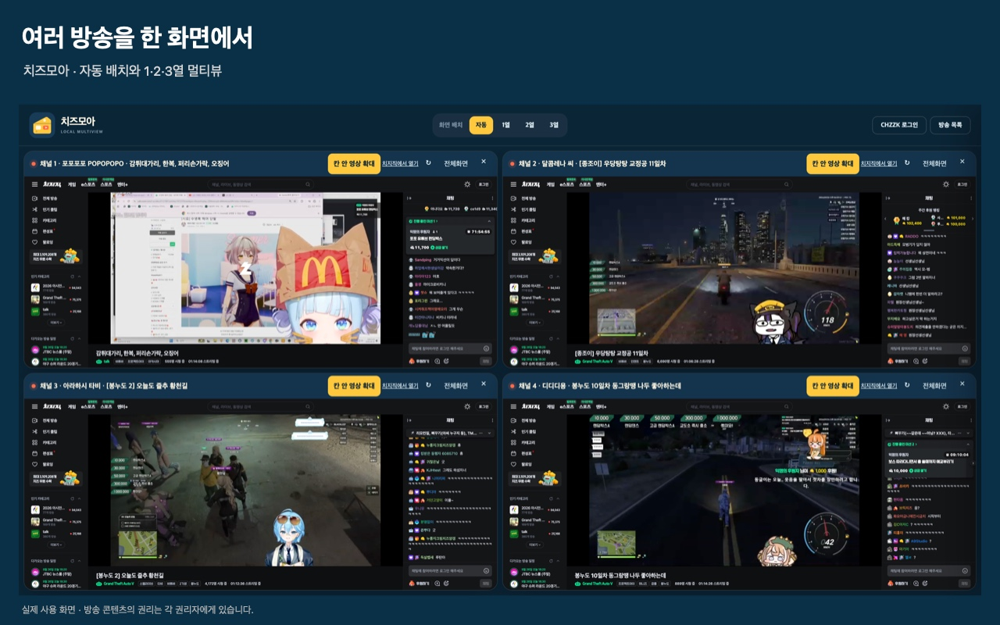
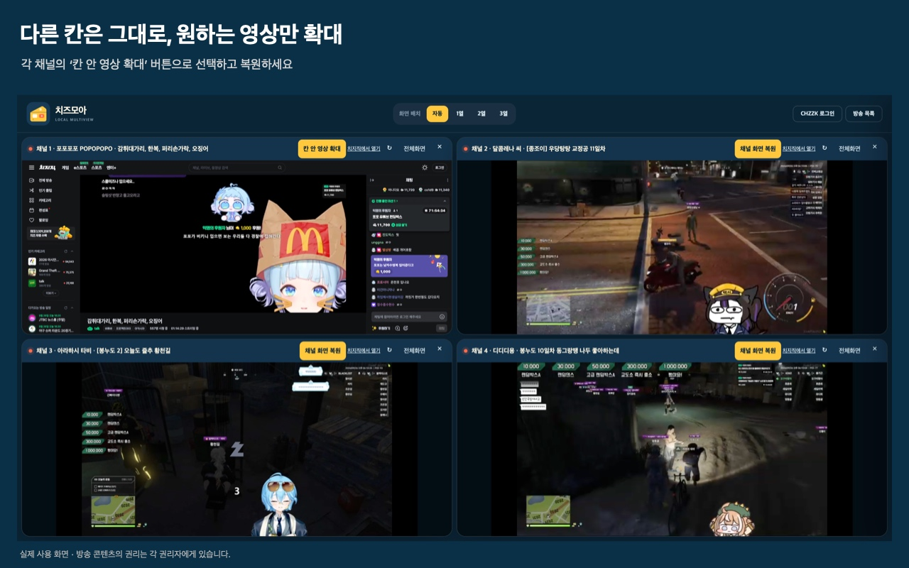
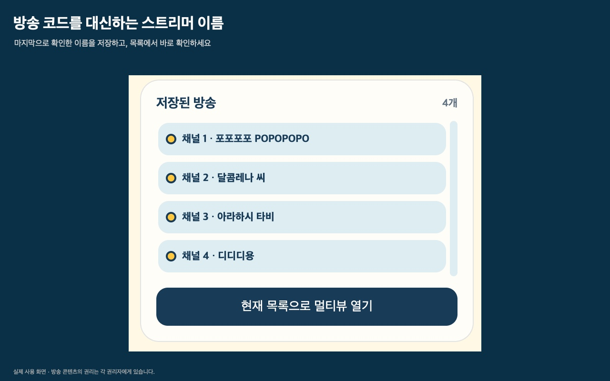

<p align="center">
  
</p>

<p align="center">
  여러 CHZZK 라이브와 다시보기를 한 화면에 모아보는 로컬 Chrome 멀티뷰
</p>

<p align="center">
  <a href="https://github.com/ThankyouJerry/CheeseMoa/releases/latest"></a>
  <a href="https://github.com/ThankyouJerry/CheeseMoa/actions/workflows/validate.yml"></a>
  <a href="LICENSE"></a>
</p>

<p align="center">
  <a href="https://github.com/ThankyouJerry/CheeseMoa/releases/latest"><strong>최신 버전 다운로드</strong></a>
  ·
  <a href="#설치하기">설치 방법</a>
  ·
  <a href="#개인정보와-권한">개인정보와 권한</a>
  ·
  <a href="PRIVACY_POLICY.md">개인정보 처리방침</a>
</p>



## 소개

치즈모아는 여러 CHZZK 방송을 하나의 Chrome 탭에 배치하는 오픈소스 확장 프로그램입니다.
별도 회원가입, 외부 멀티뷰 서버, 원격 호스팅 없이 확장 프로그램 내부에서 실행됩니다.
입력한 링크와 표시 이름, 마지막 스트리머명, 화면 배치는 사용자 PC의 현재 Chrome 프로필에만 저장됩니다. 방송 재생과 공개 방송 정보 조회에는 CHZZK 인터넷 연결이 필요합니다.

## 주요 기능

### v0.1.8 소스 업데이트

- 패널의 불필요한 위치 저장을 줄이고, 저장이 느려도 마지막 설정 하나만 대기시킵니다. 숨김·표시 접근성 상태도 실제 패널과 일치합니다.
- 이번 UI 개선 검증: [0.1.8 검증 안내](docs/QA-0.1.8.md).

- PUT 직전 재생 중단을 통신 실패 대신 로컬 재생 대기로 처리합니다. 전송되지 않은 예약만 해제하며, 전송 여부가 불확실한 수령은 재시도하지 않습니다.
- 전체 소스와 테스트는 이 저장소의 main 또는 해당 커밋 소스 ZIP에 포함됩니다. 설치용 ZIP에는 개발 도구가 포함되지 않습니다.
- 이번 수정 검증: [0.1.7 검증 안내](docs/QA-0.1.7.md).

- 내부 실행 표식은 `power-20261017.5`입니다. GitHub Release·스토어 배포 버전과는 별개입니다.
- 동일 출처 라이브 멀티뷰에서 방송을 직접 시작하고 이동 가능한 자동수령 패널에서 주 채널을 선택합니다. 자동수령은 명시적으로 ON을 눌러 사용합니다.
- 로컬 재생 준비 대기는 서버 오류 예산과 분리합니다. 빈 보상 목록, 제외 사유, 적격 중 이전 처리 기록을 구분합니다.
- 저장된 서버 수령 영수증은 조회 상태와 별도로 표시합니다. 제공 보상량과 로컬 확인 시각은 현재 잔액·공식 받기 버튼 상태와 다릅니다.
- 초기 빈 프레임은 연속 적격 상태 확인 후 최대 한 번 재연결합니다. 실제 문서나 영상이 관측된 프레임은 재연결하지 않습니다.
- 검증 범위와 클라우드 재현법: [0.1.6 검증 안내](docs/QA-0.1.6.md).


### v0.1.4 업데이트

- 창 높이에 맞춰 여러 방송을 배치하며 자동 모드에서 4개 방송은 2×2로 표시합니다.
- `칸 안 영상 확대`는 다른 칸을 유지하고 해당 칸 안의 영상만 확대합니다. `채널 화면 복원`으로 되돌립니다.
- `채널 번호 · 스트리머명 · 방송제목`으로 방송을 구분합니다.
- 마지막으로 확인한 스트리머명을 로컬에 저장하여 팝업 목록에 표시합니다. 정보 조회에 실패해도 저장된 이름은 유지됩니다.
- 팝업 목록의 잘림과 스크롤을 개선했습니다.





실제 사용 화면이며 방송 콘텐츠의 권리는 각 권리자에게 있습니다. 전체 변경 내역은 [변경 이력](CHANGELOG.md), 검증 범위와 미확인 사항은 [0.1.4 QA 기록](docs/QA-0.1.4.md)을 참고하세요. 소스 버전과 GitHub Release·Chrome Web Store 게시 버전은 다를 수 있습니다.

### 기존 기능

- 방송 추가·삭제와 화면 배치 변경 시 다른 방송의 플레이어를 유지합니다.
- 여러 멀티뷰 창과 팝업에서 목록을 수정해도 순차 저장하며, 저장 실패를 안내합니다.
- 모아보기를 다시 누르면 기존 멀티뷰 탭으로 이동합니다.
- 방송 목록의 `이름` 버튼으로 표시 이름을 지정하고, 선택한 열 수를 기억합니다.
- 카드의 `치지직에서 열기`로 원본 방송을 열 수 있습니다. 잘못된 링크는 입력란에 남겨 수정할 수 있습니다.

| 기능 | 설명 |
| --- | --- |
| 여러 방송 추가 | 라이브와 다시보기 링크를 줄 단위로 한 번에 입력합니다. |
| 자동 화면 배치 | 방송 수에 따라 1~3열 그리드를 자동으로 구성합니다. |
| 수동 레이아웃 | 자동, 1열, 2열, 3열 중 원하는 배치를 선택합니다. |
| 개별 제어 | 칸 안 영상 확대·복원, 새로고침, 제거와 별도의 전체화면 기능을 제공합니다. |
| 로그인 세션 사용 | 같은 Chrome 프로필에 로그인된 기존 CHZZK 세션을 사용합니다. |
| 로컬 저장 | 방송 목록을 `chrome.storage.local`에 저장합니다. |

## 설치하기

Chrome 116 이상이 필요합니다.

> Chrome Web Store 업데이트는 별도 심사·게시가 필요합니다. 이 저장소 업데이트만으로 스토어 설치본이 갱신되지는 않습니다. 아래는 개발자 모드 설치 방법입니다.

1. [Releases](https://github.com/ThankyouJerry/CheeseMoa/releases/latest)에서 최신 `CheeseMoa-v*.zip`을 내려받습니다.
2. ZIP을 새 폴더에 압축 해제합니다.
3. Chrome 주소창에 `chrome://extensions`를 입력합니다.
4. 오른쪽 위의 `개발자 모드`를 켭니다.
5. `압축해제된 확장 프로그램을 로드합니다`를 누릅니다.
6. 압축을 푼 폴더 중 `manifest.json`이 있는 폴더를 선택합니다.
7. Chrome 도구 모음에서 치즈모아 아이콘을 고정하면 설치가 끝납니다.

배포 ZIP의 무결성은 Release에 함께 제공되는 `SHA256SUMS.txt`로 확인할 수 있습니다.

## 사용 방법

1. Chrome 도구 모음에서 치즈모아 아이콘을 누릅니다.
2. CHZZK 링크를 한 줄에 하나씩 붙여 넣습니다.
3. `방송 모아보기`를 누르면 멀티뷰 탭이 열립니다.
4. 상단의 `자동`, `1열`, `2열`, `3열` 버튼으로 화면 배치를 바꿉니다.
5. 방송 카드의 `칸 안 영상 확대`를 누르면 다른 칸은 그대로 두고 해당 칸의 영상만 확대합니다. `채널 화면 복원`으로 돌아옵니다.
6. `전체화면`은 칸 안 확대와 별개로 해당 카드를 브라우저 전체화면으로 표시합니다.

지원하는 링크 형식은 다음과 같습니다.

```text
https://chzzk.naver.com/live/{channelId}
https://chzzk.naver.com/video/{videoId}
```

동일한 링크를 다시 입력하면 중복으로 추가되지 않습니다. 라이브와 다시보기 링크를 함께
입력할 수도 있습니다.

## CHZZK 로그인

치즈모아는 로그인 쿠키를 직접 읽거나 복사하지 않습니다. Chrome이 관리하는 기존 CHZZK
세션을 사용하며, 브라우저의 쿠키 제한에 따라 내장 프레임에는 적용되지 않을 수 있습니다.

`로그인 상태 확인`을 누르면 네이버에 현재 브라우저의 로그인 여부를 확인합니다. 멀티뷰에서 로그인 확인에 성공하면 재생 중단 안내에 동의한 뒤 모든 방송을 다시 불러옵니다. 로그인되지 않은 경우 안내의 링크로 일반 치지직 탭에서 로그인하고 다시 확인하세요. 시크릿 창과 일반 창의 세션은 별개입니다. 상태 확인 성공이 내장 화면의 로그인 성공까지 보장하지는 않으며, 웨일 실기 검증은 아직 완료하지 않았습니다.

상태 확인 요청에는 브라우저가 기존 네이버 세션을 자동으로 첨부합니다. 치즈모아는 쿠키 값을 읽거나 복사·저장하지 않으며, 응답 중 로그인 여부만 메모리에서 사용하고 나머지 프로필 필드는 버립니다.

## 개인정보와 권한

치즈모아에는 개발자 운영 분석 서버, 광고 SDK, 사용자 추적 코드가 없습니다. 방송 링크·표시 이름·마지막 스트리머명과 화면 배치는 사용자 PC의 현재 Chrome 프로필에만 저장·적용하며 다른 기기나 사용자에게 동기화하지 않습니다. 방송 재생과 공개 정보 조회 시에는 CHZZK에 해당 URL 또는 ID로 요청합니다.

자세한 데이터 처리 기준은 [개인정보 처리방침](PRIVACY_POLICY.md)에서 확인할 수 있습니다.

| 권한 | 사용하는 이유 |
| --- | --- |
| `storage` | 사용자가 추가한 방송 목록을 현재 브라우저에 저장합니다. |
| `https://comm-api.game.naver.com/*` | 버튼을 눌렀을 때 현재 브라우저의 네이버/치지직 로그인 여부를 확인합니다. 브라우저가 기존 세션을 첨부하며 쿠키 값은 읽거나 저장하지 않습니다. |
| `https://chzzk.naver.com/*` | 방송 페이지를 불러오고 영상 요소의 위치·크기를 읽어 칸 안 확대에 사용합니다. |
| `https://api.chzzk.naver.com/*` | 추가한 방송의 스트리머명과 방송제목을 조회합니다. 로그인 쿠키는 전송하지 않습니다. |

멀티뷰 제목은 `채널 1 · 스트리머명 · 방송제목`으로 표시합니다. 조회 실패는 재생에 영향을 주지 않으며 카드 새로고침으로 다시 조회할 수 있습니다. 자동 배치는 창 높이에 맞춰 표시하고 치지직 페이지 전체를 함께 축소합니다.

저장된 방송 목록에는 마지막으로 확인한 스트리머명이 표시됩니다. 이름은 로컬에 저장하며 새 조회에 성공하면 갱신하고, 실패해도 기존 이름을 유지합니다. 팝업 목록은 스크롤하여 확인할 수 있습니다.

치즈모아는 다음 작업을 하지 않습니다.

- CHZZK 쿠키 값 읽기, 복사 또는 별도 저장
- 개발자 서버로 저장된 방송 목록이나 사용자 정보 업로드
- 검색 기록, 시청 기록 또는 로그인 자격 증명 저장·수집 (로그인 여부는 버튼 요청 시에만 일시 처리)
- 원격 JavaScript 코드 다운로드 및 실행

## 알아둘 점

- 여러 방송을 동시에 재생하면 네트워크와 CPU 사용량이 증가합니다.
- Chrome 자동 재생 정책에 따라 처음 한 번 재생 버튼을 눌러야 할 수 있습니다.
- CHZZK 화면 구조나 정책이 변경되면 일부 기능이 일시적으로 동작하지 않을 수 있습니다.
- CHZZK의 광고 차단 안내가 나타날 수 있으며, 현재 그 원인이 확정되거나 해결된 것은 아닙니다.

## 개발 및 빌드

Node.js 18 이상과 `zip` 명령이 필요합니다.

```bash
git clone https://github.com/ThankyouJerry/CheeseMoa.git
cd CheeseMoa
npm ci
npm test
npm run validate
npm run build
```

`npm run build` 결과는 `dist/`에 생성됩니다.

```text
dist/
├── CheeseMoa-v{version}/
├── CheeseMoa-v{version}.zip
└── SHA256SUMS.txt
```

ZIP 최상단에는 Chrome이 요구하는 `manifest.json`이 위치합니다. `v*` 태그를 푸시하면
GitHub Actions가 테스트, 패키징, 체크섬 생성과 Release 게시를 자동으로 수행합니다.

## 프로젝트 구조

```text
CheeseMoa/
├── assets/              로고와 확장 프로그램 아이콘
├── src/popup/           도구 모음 팝업
├── src/viewer/          멀티뷰 화면
├── src/shared/          URL 파서와 로컬 저장 모듈
├── test/                URL 입력 단위 테스트
├── manifest.json        Chrome Manifest V3 설정
└── scripts/             검증 및 배포 패키징
```

## 기여하기

오류 제보와 기능 제안은 [Issues](https://github.com/ThankyouJerry/CheeseMoa/issues)에 남길 수
있습니다. 코드 변경은 테스트와 `npm run validate`를 통과한 뒤 Pull Request로 제안해 주세요.

## 라이선스 및 이용 안내

소스 코드는 [MIT License](LICENSE)로 배포됩니다.

치즈모아는 CHZZK 또는 NAVER의 공식 서비스가 아닌 독립 오픈소스 프로젝트입니다. 각 방송과
콘텐츠의 권리는 원 저작권자에게 있습니다. 사용자는 CHZZK 이용약관과 저작권을 준수해야 하며,
권리자의 허가 없이 콘텐츠를 재배포하거나 상업적으로 이용해서는 안 됩니다.

<p align="center">
  <br />
  <strong>보고 싶은 방송, 한곳에.</strong>
</p>
## 채널별 음소거 (미배포)

각 채널 상단의 `음소거` / `음소거 해제` 버튼으로 해당 칸의 소리만 제어합니다. 플레이어가 준비되기 전에는 버튼이 비활성화되며, 실제 플레이어 응답 후 상태가 표시됩니다. 치지직 플레이어에서 직접 바꾼 음소거 상태도 반영합니다.

현재 멀티뷰 창 안에서 영상 교체·채널 새로고침 시 상태를 복원합니다. 창을 닫은 뒤까지 저장하지는 않습니다. 음량이 0인 채널에서 음소거를 해제하면 음량을 50%로 설정합니다. 별도 API·쿠키 권한은 추가하지 않습니다. 자동 테스트 통과, 실제 방송 오디오 확인은 아직 미완료입니다.

# 통나무파워 시험 기능 (미배포)

자동수령 패널에서 재생 중인 라이브 주 채널 하나를 선택하고 직접 켭니다. 단일 실행 창의 소유권과 중복 방지 기록을 사용하며, 서버 대기시간을 준수합니다. 현재 빌드의 실서비스 검증 범위는 0.1.6 검증 안내를 참고하세요.

이력에는 이 PC에서 성공 응답을 확인한 시각과 확인 가능한 제공 보상량을 표시합니다. 타임아웃 등 수령 여부가 불명확한 요청은 성공으로 표시하지 않으며 무조건 재시도하지 않습니다. 새 이력은 로컬 계정 해시로 구분하고 계정 변경 시 중단합니다. 이전 계정 미구분 기록은 별도로 보존합니다. 성공 내역 삭제 후에도 중복 방지 기록은 남습니다.

쿠키 값을 추출·복사·저장하지 않습니다. 다만 로그인된 치지직 API 요청에는 브라우저의 기존 세션이 사용됩니다. 기록은 로컬에만 보관하며 별도 운영 서버로 보내지 않습니다. 시청시간 위조, 자동 팔로우, 승부예측·포인트 소비는 하지 않습니다.


## 0.1.5 자체 확장 작업 — 미배포 (2026-10-05)

- 방송 목록에서 스트리머 이름 검색과 **팔로잉 라이브**를 불러온 뒤 원하는 채널만 추가합니다. 팔로잉 전체나 오프라인 채널 목록을 가져오는 기능은 아닙니다. 검색어는 치지직에 전송되며 팔로잉은 브라우저 로그인 세션을 사용합니다. API 변경/로그인/요청 제한 오류는 표시하고 URL 입력은 계속 사용할 수 있습니다.
- 동시에 최대 4개를 표시합니다. 저장 목록과 프리셋의 방송 개수는 재생 한도와 별개이며, 기존 5·6개 이상 목록도 보존합니다. 4개를 넘겨 저장하거나 복원하면 방송 목록에서 재생할 채널을 선택합니다. 기존 선택을 해제해 교체할 수 있습니다. 새 채널 저장만으로 다섯 번째 플레이어를 실행하지 않습니다.
- 채널별 0~100% 음량과 음소거를 로컬 저장하며, **혼자 듣기**는 다른 채널을 일시 음소거합니다. 해제하거나 해당 채널을 제거하면 기존 개별 음량/음소거로 돌아갑니다. 0%를 임의로 올리지 않습니다. 솔로 상태는 저장하지 않습니다.
- 방송·배치·음량 프리셋을 최대 10개 저장/불러오기/삭제할 수 있습니다. 불러오기는 확인 후 현재 목록을 교체하며, 유지되는 방송의 iframe은 다시 만들지 않습니다. 프리셋에 로그인 정보·자동 보상 설정은 포함하지 않습니다.
- 통나무 획득은 기존 시험 기능을 보강했습니다. 새 기록은 계정 식별값을 별도 해시한 로컬 값으로 구분하며, 식별 불가·계정 변경·401/403/409/429·시간 초과에서는 중단합니다. 기존 계정 미구분 이력과 중복 방지 기록은 보존합니다. 계정 조회와 실제 보상 요청 사이의 계정 변경을 서버 측 트랜잭션으로 보장하는 것은 아닙니다.
- API 응답 기반 일반 시청 보상만 처리합니다. 시청 시간/자격 생성·예측/베팅·포인트 소비는 구현하지 않습니다. 자동 획득은 매 창에서 기본 꺼짐입니다.

새 기능은 외부 확장 코드를 복사하지 않고 치즈모아 구조에 맞춰 구현했습니다. 실제 로그인된 확장·보상 수령·오디오 출력 검증은 별도이며, 자동 테스트나 모의 브라우저 화면을 실제 수령 성공으로 취급하지 않습니다. 현재 검사 범위는 `docs/QA-0.1.6.md`를 참고하세요.

## Playback limitations and review fixes (2026-10-07)

CHZZK live pages were observed rejecting extension iframe parents through CSP on 2026-10-06. The viewer offers an explicit ordinary player link and conditional guidance, not automatic cross-origin failure detection. Opening ordinary windows was checked, but stable simultaneous playback and reward accrual remain unverified. No CSP bypass or alternative playback engine is implemented.

Saved channels and presets are preserved independently of the four active slots. Deletion prunes pending and active selections. Local volume edits take precedence over storage notifications during a drag and its pending save; explicit preset restore overrides the local edit. Live QA and log-power development remain paused.
